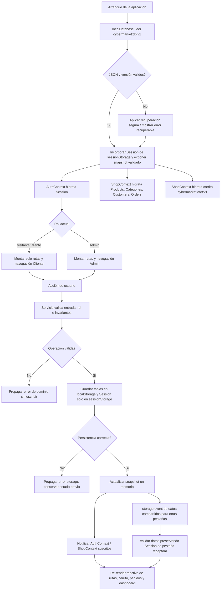

# Plan de implementación — E-commerce CyberMarket

**Estado**: Implementado; actualizado para sesiones independientes por pestaña.
**Fecha**: 2026-11-14
**Fuentes**: `.specify/memory/constitution.md` y `modules/01-auth-and-roles.md` a
`modules/05-module-recommendations.md`.

## 1. Resumen y decisiones de arquitectura

La aplicación será una SPA React/Vite con TailwindCSS, tema oscuro tech-first, Lucide React y React
Router DOM. No habrá backend ni servicios externos. La persistencia será una base relacional
simulada en `localStorage`, con tablas lógicas Products, Categories, Customers y Orders. La Session
activa se almacena por pestaña en `sessionStorage` bajo `cybermarket_session`.

La interfaz se separa por rol: visitantes/Clientes usan tienda, perfil y compras; Admin ingresa
solo con las credenciales de demostración predefinidas. El control de rol protege rutas y acciones,
además de ocultar toda navegación Admin al Cliente. Checkout, pagos y tracking son simulaciones
locales; no representan cobros ni eventos reales de transportistas.

**Decisiones de consistencia**:

- Guardar el estado relacional en un documento serializado y versionado, por ejemplo
  `cybermarket:db:v1`, que contiene las tablas compartidas y `Session: null`. Una escritura completa de este documento
  evita estados parciales entre Products, Customers y Orders.
- Mantener `cybermarket_products`, `cybermarket_orders` y `cybermarket_customers` como proyecciones
  de compatibilidad en `localStorage`, nunca como fuentes transaccionales alternativas. Si no existe
  documento canónico, importar y validar las colecciones existentes antes de guardarlo.
- Incorporar la Session de `sessionStorage` únicamente al snapshot efectivo de cada repositorio;
  servicios y guards autorizan con esa identidad. Login/logout no cambian otras pestañas. Retirar
  la Session compartida antigua sin heredar permisos ni borrar registros; solicitar nuevo login.
- El carrito se persiste por separado bajo `cybermarket:cart:v1`, ya que puede existir para un
  visitante previo al login. No es una de las tablas relacionales enumeradas en la constitución.
- Leer y escribir `localStorage` y `sessionStorage` solamente a través de un adaptador/repositorio. Los componentes no
  acceden directamente al almacenamiento.
- Publicar cambios de repositorio a los Contexts en la pestaña actual y escuchar el evento nativo
  `storage` de la base canónica y las tres colecciones para otras pestañas, preservando su Session.
  Esto actualiza vistas abiertas localmente, pero no sincroniza
  dispositivos ni usuarios remotos.
- No guardar passwords en claro. La autenticación local sigue siendo demostrativa e insegura para
  producción; la contraseña Admin está definida por la constitución y nunca debe presentarse como
  un secreto protegido por el navegador.

## 2. Arquitectura de componentes y árbol de directorios

El árbol siguiente es la estructura propuesta, no archivos ya implementados. `components/` contiene
primitivas y UI compartida; las páginas componen dominios, los Contexts exponen estado, y el
repositorio centraliza persistencia y reglas de acceso a datos.

```text
src/
├── app/
│   ├── App.jsx
│   └── providers.jsx              # AuthProvider + ShopProvider
├── components/
│   ├── layout/
│   │   ├── AppShell.jsx
│   │   ├── CustomerLayout.jsx
│   │   └── AdminLayout.jsx
│   ├── navigation/
│   │   ├── CustomerNavigation.jsx # No contiene enlaces Admin
│   │   └── AdminNavigation.jsx
│   ├── auth/
│   │   ├── LoginForm.jsx
│   │   ├── RegisterForm.jsx
│   │   └── RoleBadge.jsx
│   ├── catalog/
│   │   ├── ProductGrid.jsx
│   │   ├── ProductCard.jsx
│   │   ├── CatalogFilters.jsx
│   │   └── ProductDetailModal.jsx
│   ├── cart/
│   │   ├── CartDrawer.jsx
│   │   ├── CartLine.jsx
│   │   └── CheckoutSummary.jsx
│   ├── orders/
│   │   ├── OrderList.jsx
│   │   ├── OrderSummary.jsx
│   │   └── OrderTimeline.jsx
│   ├── profile/
│   │   ├── ProfileForm.jsx
│   │   └── AddressBook.jsx
│   ├── admin/
│   │   ├── ProductTable.jsx
│   │   ├── ProductForm.jsx
│   │   ├── LowStockAlert.jsx
│   │   ├── LogisticsQueue.jsx
│   │   ├── CustomerTable.jsx
│   │   └── MetricsDashboard.jsx
│   └── feedback/
│       ├── EmptyState.jsx
│       ├── ErrorState.jsx
│       ├── LoadingState.jsx
│       ├── ConfirmDialog.jsx
│       └── ToastRegion.jsx
├── context/
│   ├── AuthContext.jsx            # identidad, rol, sesión y login/logout
│   └── ShopContext.jsx            # catálogo, carrito y pedidos
├── hooks/
│   ├── useAuth.js
│   ├── useShop.js
│   ├── useCatalog.js              # búsqueda y filtros acumulativos
│   ├── useCart.js
│   └── useLocalDatabase.js        # estado de carga/errores del adaptador
├── routes/
│   ├── AppRouter.jsx
│   ├── PublicRoute.jsx
│   ├── CustomerRoute.jsx
│   ├── AdminRoute.jsx
│   └── routePaths.js
├── pages/
│   ├── StorePage.jsx
│   ├── LoginPage.jsx
│   ├── RegisterPage.jsx
│   ├── CheckoutPage.jsx
│   ├── ProfilePage.jsx
│   ├── MyOrdersPage.jsx
│   ├── OrderDetailPage.jsx
│   ├── NotFoundPage.jsx
│   └── admin/
│       ├── AdminDashboardPage.jsx
│       ├── AdminProductsPage.jsx
│       ├── AdminLogisticsPage.jsx
│       └── AdminCustomersPage.jsx
├── services/
│   ├── storage/
│   │   ├── localDatabase.js       # parseo, validación, migración, persistencia y suscripción
│   │   ├── databaseSchema.js      # envelope y versión de datos
│   │   └── seedData.js            # datos iniciales de catálogo
│   ├── authService.js             # registro/login/logout y validaciones de rol
│   ├── productService.js          # CRUD y validación de producto
│   ├── orderService.js            # checkout y transiciones permitidas
│   └── metricsService.js          # derivados del dataset, no fuente financiera
├── utils/
│   ├── validation.js
│   ├── currency.js
│   ├── orderStatus.js
│   └── errorMessages.js
└── styles/
    └── index.css                  # Tailwind y tokens visuales compartidos

tests/
├── unit/
├── integration/
└── journeys/
```

### Responsabilidades

- **AuthContext**: estado `loading | anonymous | authenticated`, identidad, rol Cliente/Admin y
  acciones de login, registro y logout por pestaña mediante el repositorio y `tabSession.js`.
  No guarda la contraseña en el estado de sesión.
- **ShopContext**: snapshot observable de productos, categorías, carrito y pedidos; expone acciones
  de negocio, no acceso directo a `localStorage`.
- **localDatabase**: fuente única de verdad para serialización y acceso a datos; valida schema,
  aplica migraciones seguras y publica revisiones después de escrituras exitosas.
- **Servicios**: validan invariantes antes de modificar datos (inventario, propiedad del pedido,
  transiciones válidas, permisos). No se deben repetir las mismas reglas solo en componentes.
- **Rutas**: componen layouts y guards; navegación Admin se renderiza solo dentro de AdminLayout.
- **Páginas**: coordinan estados de pantalla y componentes de dominio sin contener persistencia.

## 3. Matriz de enrutamiento

| Ruta propuesta | Acceso | Vista | Comportamiento sin permiso |
|---|---|---|---|
| `/` | Pública | Tienda / catálogo | No aplica |
| `/products/:productId` | Pública | Detalle de producto en modal o vista enlazable | Si el producto no existe/está inactivo, mostrar no encontrado |
| `/login` | Pública | Login Email/Password | Si ya hay sesión, redirigir según rol; `?mode=admin` admite Cliente sin cambiar identidad hasta autenticar Admin |
| `/register` | Pública | Registro Cliente | Si ya hay sesión, redirigir según rol |
| `/checkout` | Cliente | Resumen, dirección “Enviar a…”, confirmación simulada | Visitante va a `/login` con retorno a checkout; Admin no crea pedido Cliente |
| `/profile` | Cliente | Perfil y libreta de direcciones | Visitante va a `/login` con ruta de retorno |
| `/my-orders` | Cliente | Historial Mis Compras | Visitante va a `/login` |
| `/my-orders/:orderId` | Cliente propietario | Detalle y timeline | No autenticado va a login; pedido ajeno/no existente da respuesta genérica de no encontrado |
| `/admin` | Solo Admin | Dashboard | Sin Admin en esta pestaña, ir a `/login?mode=admin` conservando destino y sin afectar otras pestañas |
| `/admin/products` | Solo Admin | CRUD de productos | Igual que `/admin` |
| `/admin/logistics` | Solo Admin | Cola de pedidos y estados | Igual que `/admin` |
| `/admin/customers` | Solo Admin | Tabla de clientes | Igual que `/admin` |
| `*` | Según ruta | Not Found | No revelar contenido restringido |

La decisión de checkout obligatorio con cuenta se conserva. El retorno de login debe aceptar solo
rutas internas conocidas para evitar redirecciones externas. Un usuario Cliente no ve “Admin” en
navegación, menú móvil, footer ni acciones de perfil. Las rutas Admin se ocultan y además se
protegen al renderizar y al ejecutar mutaciones.

## 4. Flujo de estado reactivo: Contexts y almacenamiento compartido/por pestaña

### Principios

1. En el arranque, el adaptador lee el documento DB, valida y migra su versión e incorpora la Session
   de esta pestaña desde `sessionStorage`; los Contexts se hidratan desde ese snapshot efectivo.
2. En la pestaña actual, una acción no espera el evento `storage` (que no se dispara en la misma
   pestaña): el repositorio escribe, actualiza su snapshot en memoria y notifica a sus suscriptores.
3. En otras pestañas del mismo origen/perfil, el listener `storage` de la base y sus colecciones
   vuelve a leer y validar el documento; actualiza los Contexts sin recargar ni sustituir su Session.
4. Si el guardado falla (p. ej. cuota excedida), no se anuncia éxito ni se confirma un pedido.
5. Los cambios de Admin en un pedido notifican a ShopContext; el timeline del Cliente consume el
   mismo pedido actualizado. No existe sincronización remota.

### Diagrama



### Flujo por operación

```text
Login/registro/logout
  → authService valida credenciales/datos
  → localDatabase guarda Session solo en sessionStorage; registro también guarda Customers compartidos
  → persistencia exitosa
  → AuthContext actualiza rol/identidad
  → Router reevalúa guards y ShopContext recalcula pedidos visibles

Checkout
  → ShopContext solicita orderService.confirmCheckout()
  → verificar sesión Cliente, dirección, precios e inventario
  → escribir Orders + ajustes de inventario en un solo snapshot
  → limpiar carrito solo después de guardar el pedido
  → publicar revisión; Mis Compras y dashboard reciben la misma orden

Cambio de envío Admin
  → AdminRoute valida rol + orderService valida transición
  → guardar estado/evento en el snapshot
  → publicar revisión
  → ShopContext notifica vistas activas y el timeline cambia inmediatamente
```

**Límite localStorage**: eventos del navegador sincronizan pestañas del mismo origen, no son un
canal de tiempo real entre dispositivos. Dos escrituras simultáneas desde pestañas distintas
pueden competir; se debe documentar esta limitación, volver a validar contra el último snapshot y
evitar prometer consistencia multiusuario.

## 5. Estrategia de errores y estados vacíos

### Clases de error y respuesta

| Clase | Ejemplos | Respuesta de dominio/UI |
|---|---|---|
| Validación | Email mal formado, dirección incompleta, precio negativo, cantidad inválida | Error junto al campo; no guardar ni limpiar formulario/carrito |
| Autenticación | Credenciales incorrectas, sesión ausente | Mensaje genérico; conservar destino de retorno seguro y carrito |
| Autorización | Cliente abre `/admin`, intenta mutación Admin o lee pedido ajeno | Denegar; no renderizar datos; redirigir o mostrar “no encontrado” sin filtrar propiedad |
| Dominio | Stock insuficiente, precio cambió, transición de pedido inválida | No aplicar operación; informar qué cambió y ofrecer corregir/recargar |
| Persistencia | JSON corrupto, versión no compatible, cuota excedida, storage bloqueado | Error recuperable; mantener snapshot anterior en memoria, no afirmar guardado, ofrecer reintentar o restablecer demo con confirmación |
| Recurso ausente | Producto eliminado/inactivo, pedido desconocido | Estado no encontrado y navegación segura al catálogo o compras |
| UI inesperado | Error de render en una sección | Error boundary local con reintento; no tumbar toda la aplicación si el resto puede seguir |

No mostrar passwords ni valores internos del almacenamiento. Los mensajes deben ser claros,
español neutro y accionables; registrar detalles técnicos solo en consola durante desarrollo, no
datos sensibles.

### Estados vacíos requeridos

- **Catálogo sin productos**: explicar que no hay productos disponibles y mostrar forma de volver
  a categorías; distinguirlo de un fallo al cargar.
- **Búsqueda/filtros sin coincidencias**: mostrar términos/filtros activos y acción “Limpiar
  filtros”; no dejar una cuadrícula vacía sin explicación.
- **Detalle sin imagen/spec opcional**: placeholder visual y etiqueta “No disponible”; no inventar
  valores técnicos.
- **Carrito vacío**: texto claro y CTA “Volver a la tienda”; total en cero y checkout deshabilitado.
- **Perfil sin dirección**: guiar al cliente a añadir dirección/teléfono antes del checkout.
- **Mis Compras sin pedidos**: indicar que aún no hay compras y enlazar al catálogo.
- **Admin sin productos/pedidos/clientes**: presentar mensaje por tarjeta/tabla y no inventar
  métricas ni mostrar errores como si fueran ceros legítimos.
- **Stock bajo/agota**: diferenciar alerta `1–4` de agotado `0`; bloquear compra si no hay unidades.
- **Logística sin pedidos**: explicar que no hay órdenes para operar; mantener filtros accesibles.

### Estados de carga

Aunque `localStorage` suele ser síncrono, los proveedores deben tener estado de inicialización
para evitar renderizar rutas protegidas como públicas antes de hidratar Session. Usar skeletons o
indicadores discretos en catálogo, dashboard y carga inicial; distinguir `loading`, `empty`, `error`
y `success` en los contratos de pantalla.

## 6. Requisitos de calidad y pruebas de arquitectura

- Unitarias: validadores, filtros acumulativos, cálculo de cantidades/totales, transiciones y
  métricas con datasets vacíos.
- Integración: AuthContext con session repository; ShopContext con storage y evento de revisión;
  checkout crea pedido y decrementa stock en una sola operación observable.
- Seguridad funcional: registro nunca crea Admin; rutas directas y acciones Admin denegadas a
  Cliente; pedido ajeno no accesible; navegación Admin ausente en layouts Cliente.
- Reactividad: cambio de estado logístico actualiza la lista y timeline sin recarga; `storage`
  evento de otra pestaña rehidrata y no deja datos inválidos en contexto.
- Accesibilidad: teclado y lector de pantalla para modal, drawer, timeline, formularios y feedback;
  el color nunca es el único indicador de estado.
- Persistencia: migración/versión, JSON malformado, storage bloqueado y cuota excedida no deben
  producir falsos éxitos ni pérdida silenciosa del snapshot en memoria.

## 7. Verificación de constitución

- **Stack**: React/Vite, TailwindCSS dark tech-first, Lucide React y React Router DOM; sin backend ni
  dependencias pesadas.
- **Persistencia**: tablas lógicas obligatorias preservadas y gestionadas por capa aislada.
- **Roles**: interfaz Admin completamente oculta a Cliente, con protección real de rutas/acciones.
- **Demo segura**: pagos y credenciales descritos como simulados/locales; no se almacenan datos de
  pago reales.
- **Calidad**: vistas responsive, accesibilidad, errores/vacíos explícitos y pruebas por flujos.
- **Sin desviaciones conocidas**. El almacenamiento local y el login Admin fijo son límites
  explícitos de la constitución, no garantías de seguridad de producción.

## 8. Aprobación solicitada

Favor de revisar y aprobar o indicar cambios antes de ejecutar el plan. En particular, confirmar:

1. La estructura `src/` propuesta y el uso de una capa `services/storage/` como acceso único a
   `localStorage`.
2. Un documento versionado para las tablas relacionales, carrito en clave separada y propagación
   reactiva por suscripción interna + evento `storage` entre pestañas.
3. Las rutas/guards de la matriz y el flujo de retorno de checkout después de login.
4. El límite de “tiempo real” local y los mensajes de recuperación para datos corruptos o fallo de
   persistencia.

**Este documento es un plan propuesto; no autoriza todavía la implementación.**
